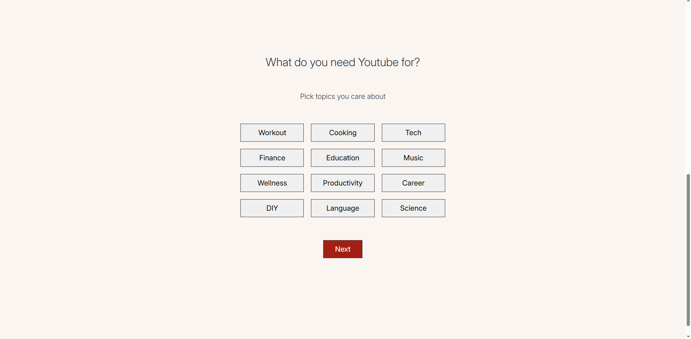
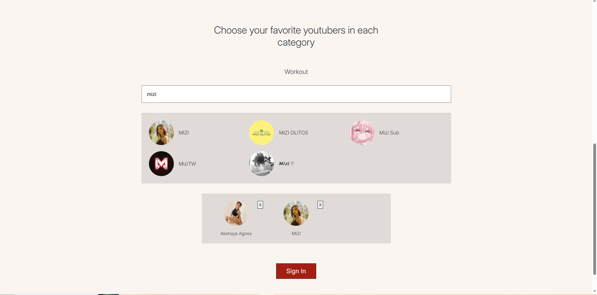
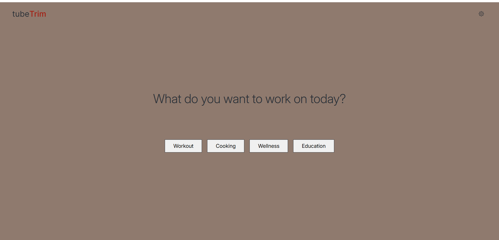
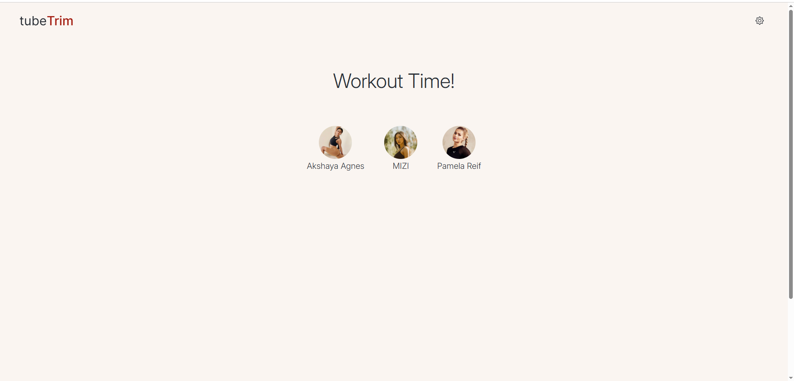
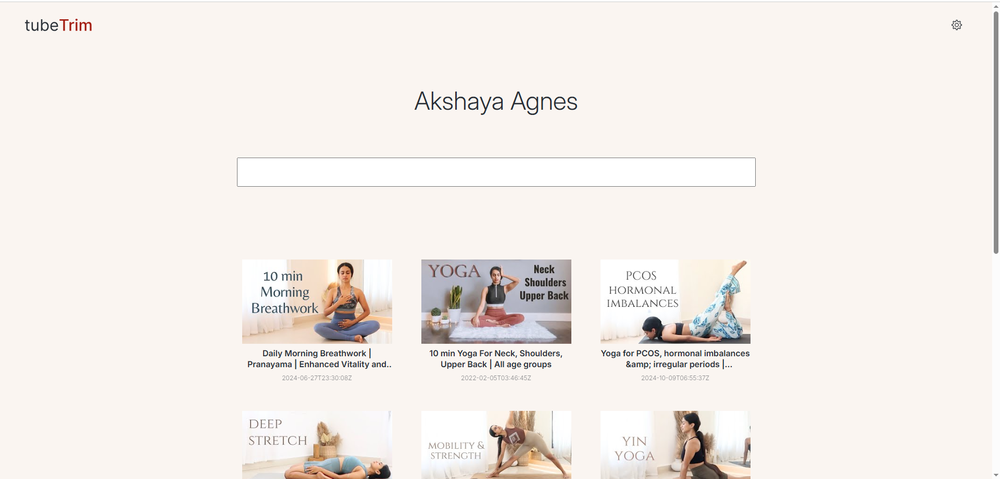
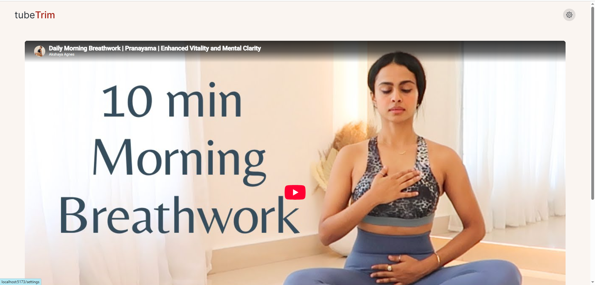
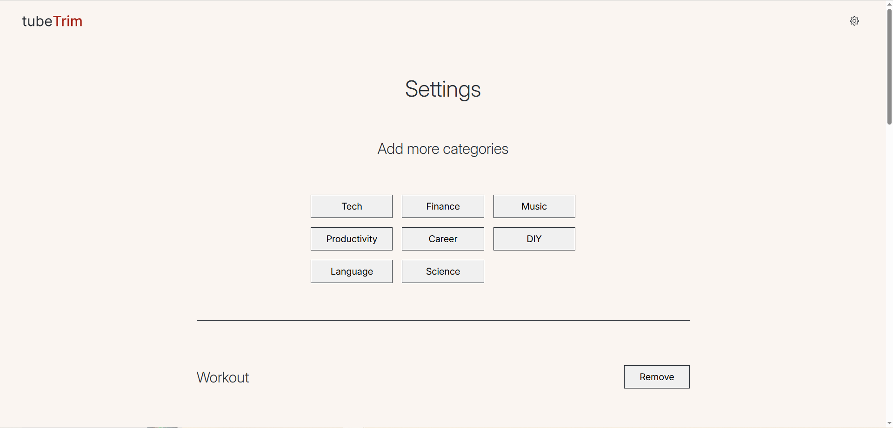
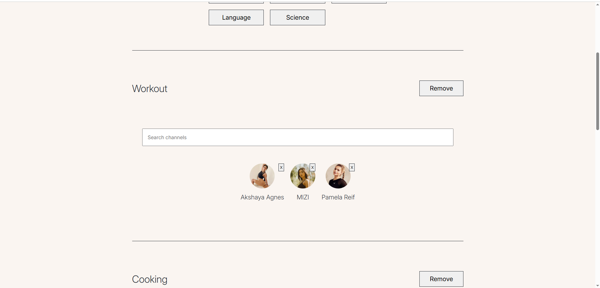
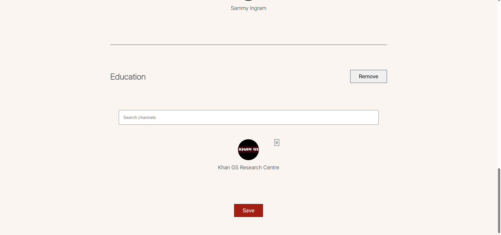

## TubeTrim

We all need YouTube, but often we don't need the spiral that comes with it. tubeTrim helps filter out the extra noise. You just pick the categories and channels that interest you and it shows only videos from those channels.

## Benefit

YouTube's feed is designed to keep you scrolling. tubeTrim is for people who open YouTube with a purpose, find what you need, and leave.

1. no feed spiral- you search intentionally for what they want which eliminates the chance of getting distracted by irrelevant recommendations
2. organized by category- every time the user enters the application, they select a category like Workout, Cooking, Tech, and more. this helps you set an intention for your visit
3. Distraction-free video player- watch without the recommendation sidebar

Tech Stack

Frontend
1. React 18 + TypeScript (Vite)
2. React Router
3. Firebase Auth + Firestore
4. Axios

Backend
1. Express + TypeScript
2. YouTube Data API v3

## How it works

Step 1

Choose up to 5 categories that match what you actually use YouTube for.

Step 2

Choose up to 5 channels you watch per category. Click the sign in button to save the data using firebase.

Step 3

This is the first page you will be directed to everytime after completing the initial sign up. You choose a category.

Step 4
Only the channels that you picked will be available. Choose a channel to browse its videos

Step 5
Browse videos or search any topic you are interested in.

Step 6

Click on the video to watch it.

Step 7

Settings page lets you:

1. Add a new category
2. Remove a category
3. Add channels to each selected category
4. Remove channels

## Watch the tubeTrim Demo video

